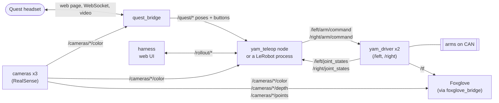

# sparklab-robotics

Software for SparkLab's bimanual robot: two [i2rt YAM-Ultra](https://github.com/i2rt-robotics/i2rt)
arms, three RealSense cameras, and a Meta Quest headset for teleoperation. Everything
talks over **ROS 2 Humble**. On top of that sit [LeRobot](https://github.com/huggingface/lerobot)
plugins for recording datasets and running policies.

Why things are built this way: [`DESIGN.md`](DESIGN.md).

**Contents**

- [How it fits together](#how-it-fits-together)
- [Where the code lives](#where-the-code-lives)
- [Topics](#topics)
- [Services](#services) — park, zero gravity, rollout control
- [Setup](#setup)
- [Everyday commands](#everyday-commands)
- [Seeing what's going on: Foxglove](#seeing-whats-going-on-foxglove) — including [the 3D view](#the-3d-view)
- [Calibrating a camera](#calibrating-a-camera)
- [Tests](#tests)
- [Adding a robot](#adding-a-robot)
- [License](#license)

## How it fits together



Read it left to right:

1. The **Quest** loads a web page from the **bridge**. The bridge publishes the
   headset and controller poses and buttons as `/quest/*` topics.
2. Something turns those poses into joint targets — either the **teleop node**
   (just driving the arms) or a **LeRobot process** (recording a dataset, or
   running a policy instead of a human).
3. That process publishes joint targets to the two **drivers**, one per arm.
   The drivers own the CAN bus, clamp every command to a safe step, and publish
   the measured joint states back.
4. The **camera node** publishes each of the three cameras as a colour image and
   a depth image (aligned pixel for pixel). The bridge streams colour to the
   headset; LeRobot records it or feeds it to the policy; any ROS tool can
   show both (see [Foxglove](#seeing-whats-going-on-foxglove)).
5. While a policy runs, the **harness** web page can retarget it or reset it
   over `/rollout/*`.

Only one thing drives the arms at a time: the teleop node *or* a LeRobot process.

## Where the code lives

| package | what it is | start reading |
|---|---|---|
| [`src/sparklab_yam`](src/sparklab_yam/README.md) | the robot: arm driver, teleop node, IK, arm model, launch file, rig config | `driver.py`, `launch/yam.launch.py` |
| [`src/sparklab_quest`](src/sparklab_quest/README.md) | the headset: bridge node, web page, controller input | `bridge.py` |
| [`src/sparklab_cameras`](src/sparklab_cameras/README.md) | the cameras: publisher node and setup tools | `node.py` |
| [`src/sparklab_gello`](src/sparklab_gello/README.md) | a GELLO leader driving one arm, joint to joint | `node.py` |
| [`src/lerobot_robot_sparklab`](src/lerobot_robot_sparklab/README.md) | LeRobot plugin: robot, teleoperator, recording, live rollout, harness | `follower.py` |
| [`src/capx_sparklab`](src/capx_sparklab/README.md) | cap-x's agent tools on both arms: an LLM writes Python against perceive / grasp / move / hand-over tools | `api.py`, `env.py` |
| [`src/sparklab_sim`](src/sparklab_sim/README.md) | Isaac Sim digital twin: the rig's ROS 2 interface on its own domain, from Isaac's own Python | `twin.py`, `policy_server.py` |
| [`scripts/`](scripts/README.md) | everyday commands and policy-debugging tools | `rollout.sh` |

The first six are ROS 2 packages, built together with `colcon`; `capx_sparklab` runs
under [`scripts/capx_python.sh`](scripts/capx_python.sh), next to cap-x's GPU stack.

## Topics

`<arm>` is `left` or `right`.

| topic | type | meaning |
|---|---|---|
| `/<arm>/joint_states` | `JointState` | measured joints 1–6 + gripper, 100 Hz |
| `/<arm>/ee_pose` | `PoseStamped` | gripper pose in the arm's base frame |
| `/<arm>/arm/command` | `Float64MultiArray` | 6 joint targets (rad) |
| `/<arm>/gripper/command` | `Float64` | gripper target, 0 closed .. 1 open |
| `/quest/head/pose`, `/quest/<arm>/pose` | `PoseStamped` | headset and controller poses |
| `/quest/<arm>/joy` | `Joy` | controller buttons and trigger |
| `/quest/<arm>/haptic`, `/quest/<arm>/engaged` | `Float32`, `Bool` | feedback shown on the headset |
| `/quest/settings` | `String` (JSON) | the headset page's tuning sliders |
| `/cameras/<id>/color/image_raw` | `Image` | colour image, RGB |
| `/cameras/<id>/depth/image_raw` | `Image` | depth in millimetres, aligned to the colour image |
| `/cameras/<id>/{color,depth}/camera_info` | `CameraInfo` | camera intrinsics |
| `/cameras/<id>/points` | `PointCloud2` | colour point cloud in the camera's frame, ≤ 10 Hz, only while something subscribes |
| `/tf`, `/tf_static` | `TFMessage` | where every arm and camera is — see [the 3D view](#the-3d-view) |
| `/rollout/task` | `String` | give a running policy a new task |
| `/rollout/status`, `/rollout/state`, `/rollout/images/<cam>/compressed` | `String`, `JointState`, `CompressedImage` | what the running policy sees |

## Services

Call these by hand from a terminal (env active, workspace sourced), or from
Foxglove's *Service Call* panel. `ros2 service list -t` shows what is up right now.

| service | type | what it does |
|---|---|---|
| `/left/park`, `/right/park` | `std_srvs/srv/Trigger` | slowly fold that arm to the all-zeros rest pose (5 s) and hold it there; returns when done; also ends zero gravity |
| `/left/zero_gravity`, `/right/zero_gravity` | `std_srvs/srv/SetBool` | `true`: the arm floats and you move it by hand (commands are ignored; the gripper keeps holding); `false`: hold where it is. Tuning: [`sparklab_yam`](src/sparklab_yam/README.md#the-driver) |
| `/rollout/reset` | `std_srvs/srv/Trigger` | send the arms home, drop queued actions, wait for a new task |
| `/rollout/home` | `std_srvs/srv/Trigger` | send the arms home and wait |
| `/rollout/park` | `std_srvs/srv/Trigger` | park the arms and wait |
| `/rollout/pause`, `/rollout/resume` | `std_srvs/srv/Trigger` | stop / continue stepping the policy |
| `/rollout/quit` | `std_srvs/srv/Trigger` | end the rollout |

The `/rollout/*` services exist only while `./scripts/rollout.sh --mode=live`
runs. They answer "queued" straight away; the rollout carries them out between
ticks.

```bash
# park one arm, or both at the same time
ros2 service call /left/park std_srvs/srv/Trigger
ros2 service call /left/park std_srvs/srv/Trigger & ros2 service call /right/park std_srvs/srv/Trigger & wait

# let the left arm float, then make it hold again
ros2 service call /left/zero_gravity std_srvs/srv/SetBool "{data: true}"
ros2 service call /left/zero_gravity std_srvs/srv/SetBool "{data: false}"

# steer a live rollout
ros2 service call /rollout/reset std_srvs/srv/Trigger
ros2 topic pub --once /rollout/task std_msgs/msg/String "{data: 'pick up the scissors'}"
```

Every node also has the standard parameter services (`<node>/get_parameters`
and friends); `ros2 param list` and `ros2 param get <node> <name>` are easier.
Our nodes read parameters only at start-up, so to change one, edit
`src/sparklab_yam/config/yam.yaml` and restart.

## Setup

One conda env holds ROS 2 (from [RoboStack](https://robostack.github.io)),
LeRobot and i2rt:

```bash
mamba create -n sparklab-ros -c conda-forge -c robostack-humble \
    python=3.12 numpy=2.2 ros-humble-ros-base colcon-common-extensions \
    ros-humble-foxglove-bridge ros-humble-rosbag2-storage-mcap
conda activate sparklab-ros
conda env config vars set LD_LIBRARY_PATH="$CONDA_PREFIX/lib" && conda activate sparklab-ros

pip install "lerobot==0.6.0" mujoco pyrealsense2 fastapi "uvicorn[standard]" aiortc av \
    opencv-python-headless pyyaml "setuptools<80" "pytest<8"
git clone https://github.com/i2rt-robotics/i2rt && pip install -e ./i2rt
pip install "lerobot_teleoperator_yamactiveleader @ git+https://github.com/uynitsuj/lerobot_teleoperator_yamactiveleader@4ed519781152562ba338a8ebcd0e4cd781b3029f"   # GELLO only
conda install -c conda-forge ffmpeg
```

The `LD_LIBRARY_PATH` line is required: without it torch and ROS load
incompatible C++ libraries. If i2rt's `ruckig` dependency fails to build, use
`pip install --no-deps -e ./i2rt` — nothing here needs ruckig.

Build, then source the workspace in every new terminal:

```bash
colcon build --symlink-install
source install/setup.bash
```

## Everyday commands

Start the robot first and leave it running; everything else connects to it.

```bash
ros2 launch sparklab_yam yam.launch.py                  # real arms, cameras, headset bridge
ros2 launch sparklab_yam yam.launch.py teleop:=true     # ...and drive the arms from the Quest
ros2 launch sparklab_yam yam.launch.py sim:=true viewer:=true cameras:=false   # no hardware
```

Ctrl-C folds both arms to the rest pose before turning the motors off. On the
headset, open the URL the bridge prints (`https://<this-machine>:8443/`).

| to... | run (with the robot started, without `teleop:=true`) |
|---|---|
| drive the arms from the keyboard, one joint at a time | `ros2 run sparklab_yam keyboard` |
| drive one arm from a GELLO leader | `ros2 run sparklab_gello gello --ros-args -p arm:=left`, then `ros2 service call /gello/arm std_srvs/srv/Trigger` |
| record a dataset | `./scripts/record_manual.sh` |
| run a policy | `./scripts/rollout.sh` |
| change the policy's task while it runs | `./scripts/rollout.sh --mode=live`, then `ros2 topic pub --once /rollout/task std_msgs/msg/String "{data: 'pick up the scissors'}"` |
| put an AI agent in charge of the task | `./scripts/rollout.sh --mode=live`, then `./scripts/harness.sh` |
| let an LLM drive both arms by writing code (cap-x) | see [`src/capx_sparklab`](src/capx_sparklab/README.md#running-a-session) |
| run a policy in Isaac instead | see [`scripts/README.md`](scripts/README.md#run-a-policy) |
| calibrate where a camera is | see [Calibrating a camera](#calibrating-a-camera) |
| see what is running | [Foxglove](#seeing-whats-going-on-foxglove), or `ros2 node list`, `ros2 topic echo /left/joint_states` |

## Seeing what's going on: Foxglove

[Foxglove](https://foxglove.dev) is our viewer: cameras, depth, plots, logs,
services and the live node graph, in the desktop app or a browser, on this
machine or from a laptop.

Start the bridge next to the robot (another terminal, env active, workspace
sourced):

```bash
ros2 launch foxglove_bridge foxglove_bridge_launch.xml port:=8766
```

Then in Foxglove: *Open connection → Foxglove WebSocket →* `ws://localhost:8766`.
From a laptop, tunnel it first with `ssh -L 8766:localhost:8766 <this-machine>`
and use the same URL — the browser version can't open `ws://` to another
machine; the desktop app can, at `ws://<this-machine>:8766`. Port 8766 because
`rollout.sh` already serves LeRobot's own Foxglove view on 8765.

Useful panels:

| panel | topic | shows |
|---|---|---|
| Image | `/cameras/top/color/image_raw` | a camera; any `color` or `depth` topic works |
| Image | `/calibration/image` | the board detection, while calibrating |
| 3D | `/cameras/<id>/points`, TF | all three point clouds and every frame in one scene — see below |
| Plot | `/left/joint_states.position[0]` | a value over time (here: left joint 1) |
| Raw Messages | any topic | the latest message, e.g. `/rollout/status` |
| Log | `/rosout` | every node's log |
| Service Call | `/left/park`, `/rollout/reset` | call a service |
| Publish | `/rollout/task` | send a message, e.g. a new task |
| Parameters | — | every node's parameters (ours are read at start-up: edit `config/yam.yaml` and restart to change one) |
| Topic Graph | — | the live node graph — the diagram above, for real |

Only topics an open panel uses are streamed, but full-size camera images are
heavy over Wi-Fi: from a laptop, watch one camera at a time. Save a set of
panels with *Layout → Export* to reuse it.

### The 3D view

Add a *3D* panel, set *Frame → Display frame* to `left_base`, and under
*Topics* turn on the three `/cameras/<id>/points` (and `/left/ee_pose`,
`/right/ee_pose` if you want the gripper poses as arrows). Under *Transforms*
every frame shows as axes. The frames:

```
left_base ─┬─ left_tool0 ── left_wrist      (tool0: live, from the driver)
           ├─ top
           └─ right_base ── right_tool0 ── right_wrist
```

Camera frames follow OpenCV: z out of the lens, x right, y down. Everything
but `<arm>_tool0` is fixed and comes from
[`config/extrinsics.yaml`](src/sparklab_yam/config/extrinsics.yaml), which the
launch publishes on `/tf_static`. A cloud costs ~0.3 MB (wrist) or ~0.9 MB
(top) per message; from a laptop, turn on one at a time.

While a cap-x session runs, both arms' models and what its tools perceive and plan
are published too — see [capx_sparklab](src/capx_sparklab/README.md#running-a-session).

**Recording raw topics** (for debugging — datasets come from `record_manual.sh`):

```bash
ros2 bag record -s mcap /left/joint_states /cameras/top/color/image_raw   # Ctrl-C to stop
ros2 bag play <folder>                                                    # replay as live topics
```

Open the `.mcap` file in the folder with Foxglove (*Open local file*) to scrub
through it on a timeline.

## Calibrating a camera

Finds exactly where a camera sits relative to an arm, using a printed ChArUco
board. Run it once per camera, and again whenever a camera is moved.

| mode | camera | the board | result |
|---|---|---|---|
| `eye_in_hand` | a wrist camera | lies still on the table | camera pose in `<arm>_tool0` |
| `eye_to_hand` | the top camera | clamped rigidly to the gripper | camera pose in `<arm>_base` |

**1. The board.** The lab's ChArUco board is already configured in
`src/sparklab_yam/config/yam.yaml`: **24 squares across × 17 down**, 15 mm
squares, 11 mm markers, `DICT_5X5_250` (it has 204 markers, more than the
5×5 set's 100-marker size holds). Keep it flat and stiff.

The markers are small, so keep the board close: about **20 cm** from a wrist
camera and within about **50 cm** of the top camera. If the live view shows few
or no corners, move closer. If the gripper can't bring the board that close to
the top camera, print a board with bigger markers for it —
`ros2 run sparklab_yam calibration_board --squares-x 7 --squares-y 5 --square-mm 35 --marker-mm 26 --dictionary DICT_5X5_100`
writes one that fits A4 — measure a printed square, and pass the same values
with `-p squares_x:=7 -p squares_y:=5 -p square_length:=0.035 -p marker_length:=0.026 -p dictionary:=DICT_5X5_100`.

**2. Start the robot** without teleop: `ros2 launch sparklab_yam yam.launch.py`.

**3. Start the calibration** for one camera and arm:

```bash
P="--ros-args --params-file src/sparklab_yam/config/yam.yaml"
ros2 run sparklab_yam calibrate $P -p mode:=eye_in_hand -p arm:=left  -p camera:=left_wrist
ros2 run sparklab_yam calibrate $P -p mode:=eye_in_hand -p arm:=right -p camera:=right_wrist
ros2 run sparklab_yam calibrate $P -p mode:=eye_to_hand -p arm:=left  -p camera:=top -p output:=calibration_top_left.yaml
ros2 run sparklab_yam calibrate $P -p mode:=eye_to_hand -p arm:=right -p camera:=top -p output:=calibration_top_right.yaml
```

The arm switches to **zero gravity**: it floats and you guide it by hand.
Support it the first time, in case it sags.

**4. Watch** `/calibration/image` in a Foxglove *Image* panel. It draws the
detected board and tells you whether the arm is still.

**5. Capture 10–20 poses.** Move the arm, hold it still, press **Enter**. Vary
the angle and distance a lot — tilt and turn the gripper, not just slide it.
Captures are refused while the arm moves or the board isn't visible.

| key (then Enter) | does |
|---|---|
| *(nothing)* | capture this pose |
| `u` | drop the last capture |
| `s` | save the result |
| `q` | quit — the arm stops floating and holds where it is |

**6. Read the running result.** After the third capture, every capture
re-solves and prints:

```
#12  camera at [21.3, -40.8, -69.5] mm, rpy [2.8, -5.8, 0.9] deg | error 1.2 mm 0.31 deg 0.62 px (worst #4: 1.90 px) | rotation spread 48 deg | board fit 0.38 px
```

- **error** — how consistently the captures agree: aim for under ~1 px and a
  few mm. If it jumps after a capture, `u` drops it.
- **worst** — the capture that fits least; if it's far above the rest, it was
  probably blurred or the arm moved.
- **rotation spread** — how much you've turned the gripper overall. Under 30°
  it warns: the answer is unreliable until you tilt and turn more.
- **board fit** — how well this capture's board alone fits the camera
  intrinsics; should be well under 1 px. If it's low but **error** is high, the
  camera is fine and the problem is on the arm side (mount, joints).

**7. Save** with `s`: it writes `calibration_<camera>.yaml` (or your `output`)
in the current directory — the transform as translation, quaternion and 4×4
matrix, the errors, and every capture (arm pose, joint angles, detected
corners). Save before quitting: `q` and Ctrl-C discard the captures.

If `calibrate` is killed instead of quit with `q`, the arm keeps floating until
you run `ros2 service call /left/zero_gravity std_srvs/srv/SetBool "{data: false}"`
(or `/right/...`). Calibrating the top camera against both arms also tells you
where the two arm bases are relative to each other.

**8. Use it.** Copy `translation_m` and `quaternion_xyzw` into the matching
entry of [`config/extrinsics.yaml`](src/sparklab_yam/config/extrinsics.yaml)
and restart the launch. `left_base → right_base` is
`calibration_top_left` × inverse(`calibration_top_right`), from the two
`matrix` fields.

## Tests

```bash
colcon test --packages-select sparklab_quest sparklab_yam sparklab_cameras sparklab_gello capx_sparklab && colcon test-result --verbose
./scripts/capx_python.sh -m pytest src/capx_sparklab/test     # cap-x's planning, on the GPU
```

They use simulated arms; no hardware needed.

## Adding a robot

Make a ROS 2 package with its driver and launch file (reuse the YAM topic names
to get Quest teleop for free), then add a LeRobot `Robot` class to
`lerobot_robot_sparklab` and re-export it from that package's `__init__.py`.

## License

Apache-2.0.
